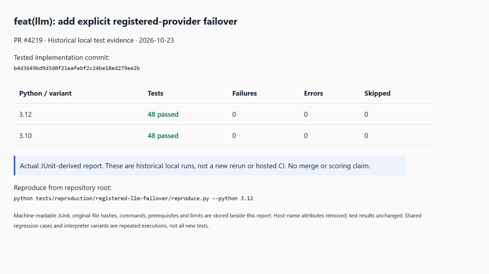

# Reproduction and local test evidence



feat(llm): add explicit registered-provider failover

This directory makes the previously reported local evidence reviewable. **It is not a GitHub CI result.** The tested implementation commit is `b4d3649bd9d3d0f21eafebf2c24be18ed279ee2b`. Subsequent evidence/documentation-only commits do not turn these historical runs into fresh executions.

## Reproduce

Install Python 3.10+ and [uv](https://docs.astral.sh/uv/getting-started/installation/), then from the repository root run:

```sh
python tests/reproduction/registered-llm-failover/reproduce.py --python 3.10
python tests/reproduction/registered-llm-failover/reproduce.py --python 3.12
```

Use `--dry-run` to inspect commands without installing or executing anything. The runner uses a scoped dependency environment, not a full-project installation. It records resolved package versions, actual pytest output and JUnit in a fresh temporary directory; `--output-dir` can select a separate directory. Do not overwrite the checked-in historical evidence. Dependencies without `==` were not fully locked in the original runs; the new environment record allows differences to be inspected, rather than pretending the old environment was hermetic.

## Prerequisites and limits

Tests use synthetic or repository fixtures and local temporary resources. They do not call paid model providers or use private user data. The required Python packages are in requirements.txt; preserve the feature's documented scope and limitations.

## Historical evidence

| Python | Tests | Failures | Errors | Skips | JUnit |
| --- | ---: | ---: | ---: | ---: | --- |
| 3.12 | 48 | 0 | 0 | 0 | [junit-py3.12.xml](junit-py3.12.xml) |
| 3.10 | 48 | 0 | 0 | 0 | [junit-py3.10.xml](junit-py3.10.xml) |

`evidence.json` includes the original local JUnit SHA-256 values. Shared regressions and repeated Python environments are not independent new tests. Host-name attributes were removed for privacy; case results and original timestamps are retained. The timestamp fields have no explicit timezone, so no timezone is inferred.

Open `report.html` to inspect the rendered summary. The accompanying report screenshot is a capture of that actual JUnit-derived report, not a terminal screenshot or proof of hosted CI. See the feature guide and PR for unsupported cases. Full-repository CI, merge acceptance and competition scores are not claimed.

中文：这里公开真实本地测试记录与跨目录复现入口，明确关联被测提交。历史记录不是刚重跑的结果，也不是上游CI。只有关键依赖固定版本，原环境不是完整锁文件；复现时另存实际环境与输出。未包含真实用户数据或付费模型调用。
